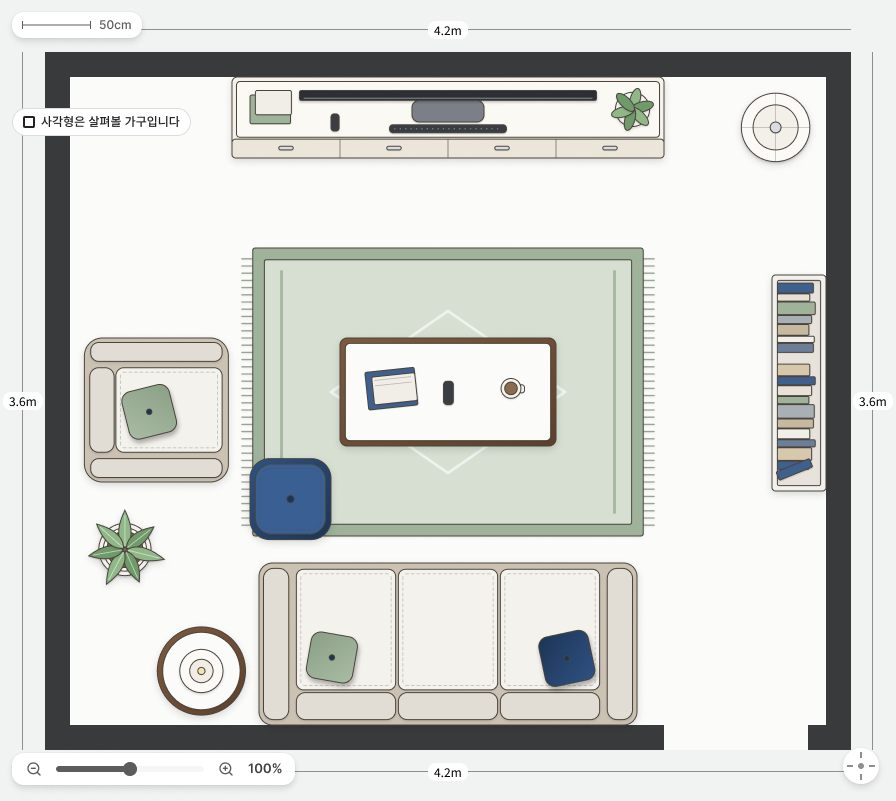
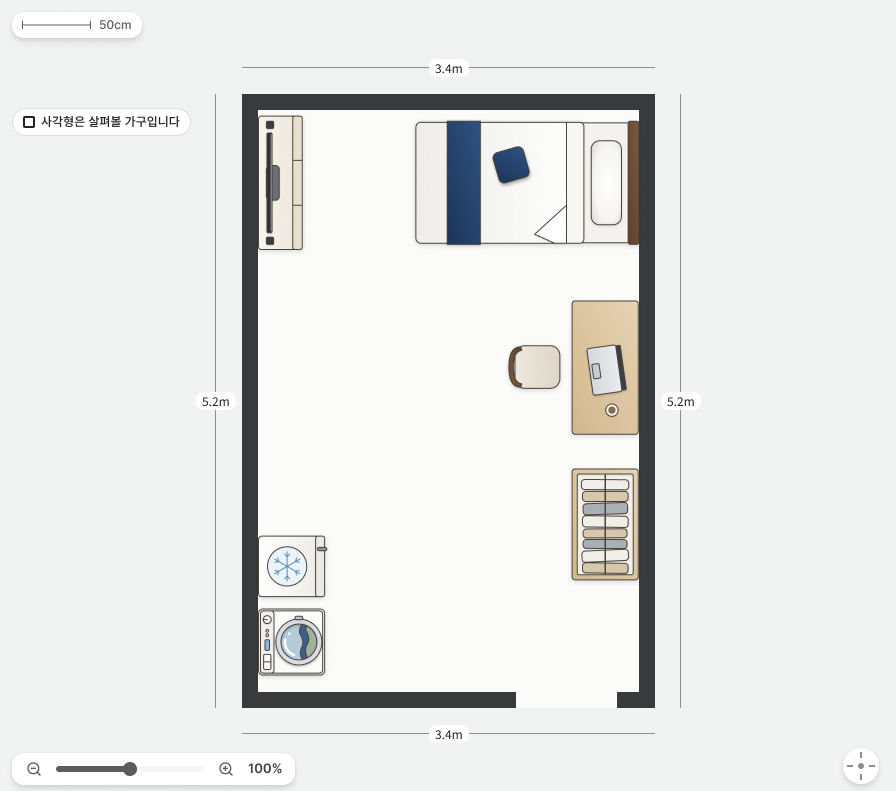

# 평담

이사 전에 **내 가구가 새 집에 들어가는지** 미리 확인하는 가구 배치 서비스입니다.
직접 꾸린 AI 에이전트 개발 흐름으로 만들고 있습니다.

| 거실 4.2×3.6m | 원룸 3.4×5.2m |
|---|---|
|  |  |

지금 만들고 있는 배치 편집기 화면의 디자인 시안입니다. 가구는 실제 치수 비율대로 위에서 내려다본 모양으로 그립니다.

## 무엇을 하나

| 단계 | 하는 일 |
|---|---|
| 도면 가져오기 | 평면도 사진·PDF를 올리거나 표준 평형 템플릿에서 시작 |
| 방 확정 | 도면 인식이 만든 방 초안을 사용자가 확인하고 벽·문·창을 확정 |
| 축척 | 평수와 실측으로 도면 축척을 맞춤 |
| 배치 | 내 가구 라이브러리와 프리셋에서 가구를 골라 직접 배치 |
| 판정 | 가구별·방별로 초록·노랑·빨강 3등급과 그 이유를 문장으로 표시 |

판정은 가구 간 겹침과 여유, 문 여닫이 공간, 벽에 붙여야 하는 무타공 가구의 벽 접촉을 좌표와 치수로 계산합니다.

## 설계에서 내린 판단

### AI 자동배치는 만들었다가 접었습니다

처음에는 AI가 배치안을 제안하고 코드가 검증하는 구조로 설계했습니다. 그런데 서비스 흐름을 처음부터 끝까지 이어 보니, 생성 결과는 검증할 좌표가 없는 문장이었고 결과 이미지는 실제 집과 무관한 임의 사진이었습니다. 그 경로가 첫 화면의 주 동선을 차지하고 있어서, 방문자는 작동하지 않는 기능부터 안내받고 있었습니다.

그래서 AI 생성 경로를 이루던 백엔드 서비스 7개를 통째로 걷어내고, 사용자가 직접 배치하면 코드가 판정하는 구조로 다시 짰습니다. 도면 인식은 수동 경로에도 필요해서 남겼지만 **방 초안을 만드는 데까지만** 맡기고, 벽은 사용자가 확정합니다. 인식 모델은 인터페이스 뒤에 두어, 품질과 비용에 따라 구현체만 바꿔 끼울 수 있게 했습니다.

### 등급과 신뢰도를 다른 축으로 냅니다

판정은 등급(초록·노랑·빨강)과 신뢰도(추정·확신)를 따로 냅니다. 실측이 끝나지 않았다고 등급을 숨기지 않고, 확인되지 않은 값으로 낸 등급에는 「추정」을 붙입니다. 그 대신 안 들어가는 가구가 초록을 받지 않도록 계산은 보수적으로 잡았습니다. 회전한 가구는 외접 사각형으로 크게 잡아, 판정이 틀리더라도 「들어간다」 쪽이 아니라 「안 들어간다」 쪽으로 틀리게 했습니다.

### 판정을 계산·사실·표현 세 층으로 나눴습니다

판정 엔진은 부수효과 없는 순수함수로, 위반 하나하나를 「사실」이라는 구조체로 내놓을 뿐 한국어 문장을 모릅니다. 엔진이 내놓은 사실을 사용자가 읽는 문장으로 바꾸는 일은 이유 모듈 하나가 맡고, 화면이 직접 짓던 나머지 문구는 문구 모듈 한 곳으로 모았습니다. 같은 판정을 보여주는 화면이 세 곳이라, 문구가 화면마다 복제돼 있으면 한 곳만 고쳐져도 아무 테스트에도 걸리지 않기 때문입니다.

## 트러블슈팅

판정의 전제는 실제로는 안 들어가는 가구를 초록으로 통과시키지 않는 것이었습니다. 시스템 전체를 다시 훑어보니 이 전제가 한 번도 성립한 적이 없었습니다. 좌표 프레임의 종횡비가 뒤집혀 4:3 거실이 세로로 긴 방으로 저장됐고, 그 위에서 계산한 축척이 방마다 어긋났습니다.

수정은 좁았습니다. 프레임 정의에서 세로축 제수 한 곳을 가로축과 통일했고, 좌표를 쓰는 쪽 코드는 한 줄도 바뀌지 않았습니다. 그 코드는 이미 옳게 짜여 있었고, 뒤집힌 프레임 위에서 돌고 있었을 뿐입니다. 프레임이 바로 선 뒤에는 축척을 줄자 없이 전용면적 하나로 전체 평면에서 구하게 바꿨습니다.

테스트 1,400여 개가 통과 중이었지만 이 결함은 잡지 못했습니다. **버그를 넣어도 전부 통과했고 수정을 넣어도 전부 통과했습니다.** 기존 테스트가 요소가 있는지만 보고 좌표 값은 한 번도 확인하지 않았기 때문입니다. 그 뒤로 완료 기준을 테스트 개수에서 **고치기 전에 반드시 실패하는 반례 테스트**로 바꿨습니다.

## 테스트

- **프론트엔드**: Vitest 테스트 파일 300여 개, Playwright E2E 91개 스펙. 거짓 초록이 나오면 실패하는 반례 E2E를 게이트로 둡니다.
- **백엔드**: 테스트 580여 개. 통합 테스트는 Testcontainers PostgreSQL 16에 Flyway 마이그레이션 전체를 적용해 돌립니다. 컨테이너는 JVM당 한 번만 띄워, 클래스마다 재시작하며 포트가 바뀌어 나던 연결 실패를 없앴습니다. 연관 로딩이 N+1로 퇴화하면 발행 SQL 횟수 단언에서 깨지게 했습니다.
- **스키마**: Flyway 마이그레이션 28개가 단일 출처입니다. 운영에서는 `ddl-auto: none`으로 두고, 테스트에서는 `validate`로 코드와 스키마가 맞는지 확인합니다.

## 기술 스택

| 영역 | 스택 |
|---|---|
| 백엔드 | Java 21, Spring Boot 3.5, Spring Security, JPA, Flyway, WebFlux |
| 데이터베이스 | PostgreSQL 16 |
| 프론트엔드 | React 19, TypeScript, Vite, Tailwind CSS v4, TanStack Query, React Router 7 |
| 도면 인식 | VLM, 인터페이스 뒤 교체 가능 구조 |
| 테스트 | JUnit 5, Testcontainers, Vitest, Testing Library, Playwright |

## 개발 기록

[donghyos.github.io](https://donghyos.github.io)
